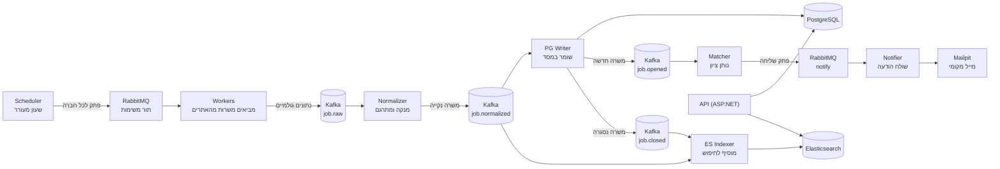

# רדאר משרות: אפיון ראשוני

גרסה ראשונה וקצרה. הפירוט והנימוקים לכל החלטה נמצאים ב-[00-decisions.md](00-decisions.md).

## מטרה
ללמוד לבנות מערכת פייפליין (צינור שמעביר נתונים משלב לשלב) מקצה לקצה, ולהכיר דרכה את הטכנולוגיות: Docker Compose, RabbitMQ, Kafka, PostgreSQL, Elasticsearch וניטור. הנושא שעליו לומדים: איסוף משרות טק בישראל ושליחת התראה על משרות שמתאימות לי.

כשיש התנגשות בין למידה לתוצאה מהירה, הלמידה קודמת.

## מה המערכת עושה
1. כל 6 שעות שעון מעורר כותב "פתק" לכל אחת מכ-185 חברות.
2. עובדים לוקחים פתקים מתור, הולכים לאתר המשרות של החברה ומביאים את המשרות.
3. המשרות נכתבות כמו שהן ליומן (Kafka).
4. מסדר קורא מהיומן, מנקה ומתרגם כל משרה לפורמט אחיד, ומוציא ממנה כישורים.
5. המשרות נשמרות במסד (PostgreSQL) ומאונדקסות לחיפוש (Elasticsearch).
6. בודק התאמה נותן ציון לכל משרה חדשה. אם הציון גבוה, נשלח מייל לשרת מייל מקומי.

## תרשים

## הרכיבים בקצרה

| רכיב | מה הוא עושה | טכנולוגיה |
|---|---|---|
| Scheduler | כותב פתק סריקה לכל חברה כל 6 שעות | APScheduler (ספריית Python) |
| תור משימות | מחלק פתקים לעובדים, עם ניסיונות חוזרים ו-DLQ (ערימה לפתקים שנכשלו) | RabbitMQ |
| Workers | מביאים משרות גולמיות מהאתרים, עובד לכל מערכת גיוס | קוד שלנו |
| יומן | שומר את כל האירועים לפי הסדר ומאפשר לקרוא שוב | Kafka |
| Normalizer | מנקה, מתרגם לפורמט אחיד, מוציא כישורים | קוד שלנו |
| PG Writer | שומר במסד ומזהה משרה חדשה, שהשתנתה או נסגרה | קוד שלנו, PostgreSQL |
| ES Indexer | מוסיף משרות לאינדקס החיפוש | קוד שלנו, Elasticsearch |
| Matcher | נותן ציון התאמה מול הפרופיל | קוד שלנו |
| Notifier | שולח הודעה, בקצב מבוקר | קוד שלנו, Mailpit |
| API | חיפוש משרות, פרופיל, היסטוריית התראות | ASP.NET Core, Dapper |
| ניטור | מראה אם הפייפליין בריא | Prometheus, Grafana |
| הרצה | הכול עולה בפקודה אחת | Docker Compose |

## הנתונים (טבלאות ב-PostgreSQL)
`companies` (חברות), `job_postings` (משרות), `job_skills` (כישורי משרות), `job_events` (היסטוריית שינויים), `users` (משתמשים), `user_profiles` (מה כל משתמש מחפש), `notifications` (התראות), `scan_runs` (היסטוריית סריקות).

מזהה משרה: `מערכת_גיוס:ח.פ:מזהה_במערכת`, למשל `greenhouse:513674309:8256182`.

## מה בגרסה הראשונה ומה לא

| בפנים | בחוץ, לפחות בינתיים |
|---|---|
| Comeet ו-Greenhouse | LinkedIn ואתרי דרושים |
| כ-185 חברות מ-Techmap | זיהוי אוטומטי של מערכת גיוס מקישורי קריירה |
| משתמש אחד, אבל עם `user_id` בכל מקום | הרשמה והתחברות של משתמשים נוספים |
| התראה במייל מקומי (Mailpit) | טלגרם |
| API וניטור | Airflow, פריסה בענן, Schema Registry (תוספות אם יישאר זמן) |

## איך נדע שהצלחנו
- `docker compose up` מרים את כל המערכת על מחשב נקי.
- הפייפליין מביא משרות אמיתיות, שומר אותן ומאפשר לחפש.
- משרה חדשה שמתאימה לפרופיל מייצרת התראה אחת בלבד.
- אם worker קורס באמצע סריקה, שום משרה לא אובדת.
- אני יכול להסביר מה כל רכיב עושה ולמה בחרנו בו.

## החלטות פתוחות
- `job.opened`: הבודק קורא אותו ולא את `job.normalized`. הנחתי שמסכימים.
- משרה שנפתחת מחדש עם מזהה חדש: האם לזהות אותה?
- Lever: צריך לאמת לפני שמסתמכים עליו.
- רישיון Techmap (ODbL) מחייב ייחוס אם המאגר מתפרסם.
- Comeet נשען על נתונים מוטמעים בעמוד ולכן עלול להישבר.
